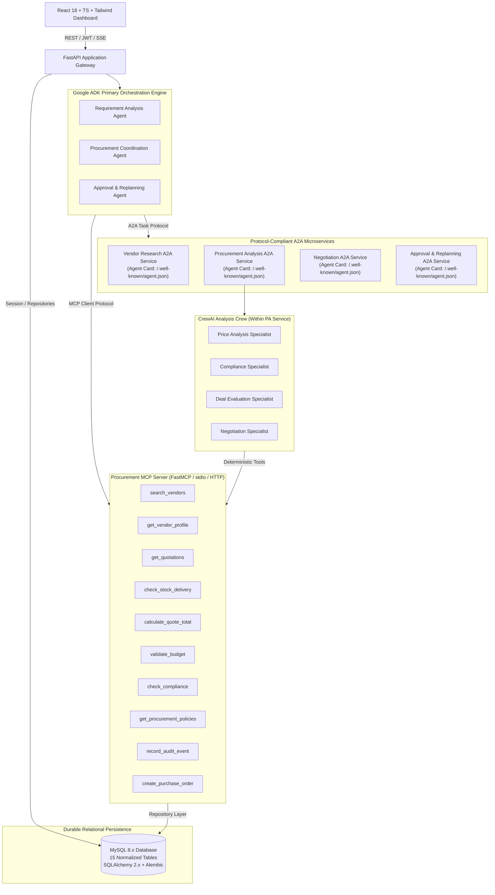

# DealForge AI — System Architecture Specification

## 1. Architectural Vision

DealForge AI is an enterprise-grade agentic procurement automation platform designed to deliver end-to-end multi-agent orchestration, verifiable compliance, deterministic financial accuracy, and robust human-in-the-loop governance.

The system replaces ad-hoc or probabilistic decision-making with a dual-engine architecture:
1. **Google Agent Development Kit (ADK)** acts as the **primary orchestrator**, directing the complete procurement lifecycle from request decomposition through vendor discovery, risk validation, approval gating, and replanning.
2. **CrewAI** operates as a specialized **procurement analysis crew**, performing deep evaluation of quotes, trade-offs, compliance evidence, and negotiation strategies.
3. **Model Context Protocol (MCP)** provides a secure, standardized tool interface between agents and the application data layer.
4. **Agent-to-Agent (A2A)** protocol enables decentralized, asynchronous communication between separately addressable agent services with standard Agent Cards and task lifecycles.
5. **Deterministic Domain Services** strictly govern financial arithmetic, compliance gates, scoring weights, and approval policies using exact `Decimal` precision.
6. **MySQL 8.x** is the durable persistent source of truth, backed by SQLAlchemy 2.x and Alembic migrations.
7. **React, TypeScript, and Tailwind CSS** provide an auditable, interactive procurement dashboard.



---

## 2. Component Architecture & Responsibilities

### A. Google ADK Orchestrator
- **Requirement Analysis Agent**: Parses unstructured request text into validated typed schemas (`PurchaseRequestExtract`), identifies ambiguities, and enforces requirement completeness.
- **Vendor Research Agent**: Delegates supplier discovery to the A2A Vendor Research Service and MCP catalog search tools.
- **Procurement Coordination Agent**: Sequentially executes deterministic pricing, invokes CrewAI analysis via A2A, and scores eligible vendors.
- **Approval and Replanning Agent**: Enforces organizational governance thresholds, manages paused approval states, and dynamically invalidates stale stages upon requirement or vendor shifts.

### B. A2A Protocol Services & Agent Cards
Each service runs as a separately addressable endpoint exposing an Agent Card (`/.well-known/agent.json`):
1. **Vendor Research Service (`/a2a/vendor-research`)**: Discovers candidate products, validates stock and catalog availability.
2. **Procurement Analysis Service (`/a2a/procurement-analysis`)**: Houses the CrewAI specialized analysis crew. Accepts structured quotation datasets and returns validated explanations and trade-offs.
3. **Negotiation Service (`/a2a/negotiation`)**: Formulates data-backed counter-offers within policy constraints.
4. **Approval & Replanning Service (`/a2a/approval-replanning`)**: Manages risk auditing, human escalation routing, and dependency re-evaluation.

### C. CrewAI Specialized Analysis Crew
Executed within the Procurement Analysis A2A Service:
1. **Price Analysis Specialist**: Interprets exact price breakdowns, volume discounts, GST, and logistics charges.
2. **Compliance Specialist**: Audits certifications (ISO, BIS, RoHS), active status, and warranty SLAs.
3. **Deal Evaluation Specialist**: Explains multi-attribute trade-offs between compliant alternatives.
4. **Negotiation Specialist**: Drafts evidence-based negotiation rationale.

### D. Model Context Protocol (MCP) Server
Exposes standardized, secure tools to agents:
- Enforces strict Pydantic argument schemas.
- Uses allowlisted parameterized queries through the repository layer.
- Prohibits arbitrary SQL execution.
- Masks sensitive credentials and validates session tokens for mutating actions.

### E. Deterministic Domain Services
Core financial and compliance logic remains isolated from probabilistic LLM outputs:
- **PricingService**: Uses Python `Decimal` for currency arithmetic, applying bulk discounts, 18% GST, and shipping.
- **BudgetService**: Verifies ceilings, calculates overrun margins, and enforces strict rejection on violations.
- **ComplianceService**: Evaluates criteria returning structured `PASS`, `FAIL`, or `UNKNOWN` statuses.
- **EvaluationService**: Normalizes metrics and applies weighted ranking exclusively to `ELIGIBLE` vendors.
- **ApprovalService**: Enforces approval rules based on transaction size, overrun status, and compliance flags.
- **ReplanningService**: Detects state invalidation boundaries and manages staged rollbacks.

---

## 3. Workflow State Machine

The procurement lifecycle transitions across formal, persisted states:

```
CREATED
   │
   ▼
REQUIREMENT_VALIDATION ──[Missing Critical Fields]──► BLOCKED_NEED_CLARIFICATION
   │
   ▼
VENDOR_RESEARCH ──────────[No Active Vendors]──────► FAILED_NO_VENDORS
   │
   ▼
ANALYSIS (CrewAI Analysis Crew via A2A)
   │
   ▼
EVALUATION (Deterministic Scoring & Ranking)
   │
   ▼
NEGOTIATION (Counter-Offer Drafting)
   │
   ▼
AWAITING_APPROVAL ────────[Rejected by Approver]───► REPLANNING / REJECTED
   │
   ▼ [Approved by Manager / Finance Reviewer]
APPROVED
   │
   ▼
FINALIZED (Purchase Order Issued & Committed)
```

---

## 4. Security & Governance

1. **Authentication**: JWT token-based authentication with cryptographically secure password hashing (PBKDF2/bcrypt).
2. **Role-Based Access Control (RBAC)**:
   - `Procurement Manager`: Can create requests, view evaluations, draft negotiations, approve up to standard policy limits.
   - `Finance Reviewer`: Can approve transactions exceeding executive thresholds, review budget overruns, and audit pricing.
   - `Administrator`: Full system governance, policy management, user management, and audit log inspection.
3. **State Locking**: Approval endpoints enforce strict idempotency and optimistic version locking to prevent duplicate or conflicting decisions.
4. **Auditability**: Every agent action, tool invocation, human decision, and replanning event is immutably logged to `procurement_audit_logs`.
