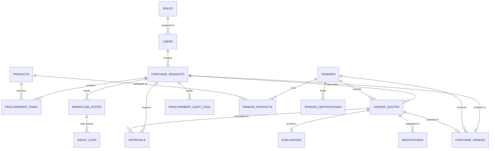

# DealForge AI — Relational Database Architecture

The DealForge AI data store is built on **MySQL 8.4** managed via **SQLAlchemy 2.x** and versioned with **Alembic**.

All monetary values are modeled with exact fixed-precision `DECIMAL(15, 2)` types to eliminate binary floating-point drift. Timestamps are consistently recorded in UTC.

---

## 1. Entity-Relationship Model

---

## 2. Table Inventory and Schema Specifications

### Identity & Access
1. `roles`: `role_id` (PK, CHAR(36)), `role_name` (UNIQUE), `description`, `permissions` (JSON).
2. `users`: `user_id` (PK, CHAR(36)), `email` (UNIQUE), `full_name`, `hashed_password`, `role_id` (FK), `department`.

### Suppliers & Products
3. `vendors`: `vendor_id` (PK, CHAR(36)), `vendor_name`, `contact_email`, `vendor_rating` (DECIMAL(3, 2)), `active_status` (BOOL), `is_preferred` (BOOL), `country`.
4. `vendor_certifications`: `cert_id` (PK), `vendor_id` (FK), `cert_name` (e.g. ISO-9001, SOC2), `issuing_body`, `issued_date`, `expiry_date`, `status` (ACTIVE, EXPIRED).
5. `products`: `product_id` (PK), `product_name`, `category`, `base_sku`, `description`.
6. `vendor_products`: `vendor_product_id` (PK), `vendor_id` (FK), `product_id` (FK), `unit_price` (DECIMAL(15, 2)), `stock_quantity`, `delivery_days`, `warranty_months`, `minimum_order_quantity`, `discount_rules` (JSON).

### Policies & Governance
7. `procurement_policies`: `policy_id` (PK), `policy_code` (UNIQUE), `title`, `description`, `policy_type`, `rules_json` (JSON), `is_mandatory` (BOOL).
8. `compliance_rules`: `rule_id` (PK), `rule_name`, `rule_type`, `parameters` (JSON), `is_active` (BOOL).

### Procurement Execution
9. `purchase_requests`: `request_id` (PK), `requester`, `raw_request_text` (TEXT), `product_requirements` (JSON), `quantity`, `budget_limit` (DECIMAL(15, 2)), `currency` (VARCHAR(3)), `delivery_deadline_days`, `warranty_requirement_months`, `status` (VARCHAR(30)).
10. `procurement_items`: `item_id` (PK), `request_id` (FK), `product_name`, `category`, `quantity`, `specifications` (JSON), `target_unit_price` (DECIMAL(15, 2)).
11. `vendor_quotes`: `quote_id` (PK), `request_id` (FK), `vendor_id` (FK), `unit_price` (DECIMAL(15, 2)), `quantity`, `discount` (DECIMAL(15, 2)), `tax` (DECIMAL(15, 2)), `shipping_cost` (DECIMAL(15, 2)), `total_amount` (DECIMAL(15, 2)), `delivery_days`, `warranty_months`, `availability_status`, `quote_status`, `calculation_breakdown` (JSON).

### Evaluations & Commercials
12. `evaluations`: `evaluation_id` (PK), `request_id` (FK), `quote_id` (FK), `price_score` (DECIMAL(5, 2)), `delivery_score` (DECIMAL(5, 2)), `warranty_score` (DECIMAL(5, 2)), `compliance_score` (DECIMAL(5, 2)), `specification_score` (DECIMAL(5, 2)), `final_score` (DECIMAL(5, 2)), `eligibility_status` (ELIGIBLE, INELIGIBLE), `exclusion_reason`, `explanation` (TEXT), `rank` (INT).
13. `negotiations`: `negotiation_id` (PK), `request_id` (FK), `quote_id` (FK), `original_amount` (DECIMAL(15, 2)), `target_amount` (DECIMAL(15, 2)), `counter_offer_amount` (DECIMAL(15, 2)), `justification` (TEXT), `draft_message` (TEXT), `negotiation_status`, `vendor_response` (TEXT).
14. `approvals`: `approval_id` (PK), `request_id` (FK), `quote_id` (FK), `risk_assessment` (JSON), `approval_reason` (TEXT), `requested_by`, `decision` (PENDING, APPROVED, REJECTED), `decided_by`, `approver_role`, `comments` (TEXT), `decided_at` (DATETIME).
15. `purchase_orders`: `purchase_order_id` (PK), `request_id` (FK), `vendor_id` (FK), `quote_id` (FK), `order_number` (UNIQUE, VARCHAR(50)), `approved_total` (DECIMAL(15, 2)), `currency`, `status` (ISSUED), `approved_by`, `order_details` (JSON).

### Audit & State
16. `workflow_states`: `workflow_id` (PK), `request_id` (FK, UNIQUE), `current_step`, `status`, `state_data` (JSON), `last_error`, `updated_at`.
17. `agent_logs`: `log_id` (PK), `workflow_id` (FK), `request_id`, `agent_name`, `event_type`, `status`, `input_summary`, `output_summary`, `error_message`, `metadata_json` (JSON), `started_at`, `completed_at`.
18. `procurement_audit_logs`: `audit_id` (PK), `request_id`, `action`, `actor`, `actor_role`, `timestamp`, `details` (JSON), `ip_address`.
